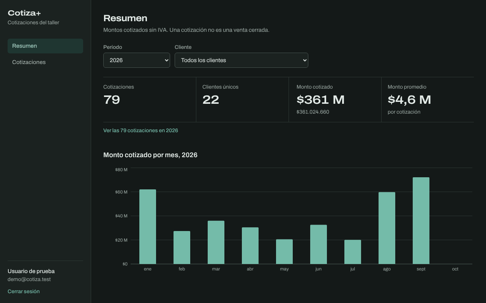
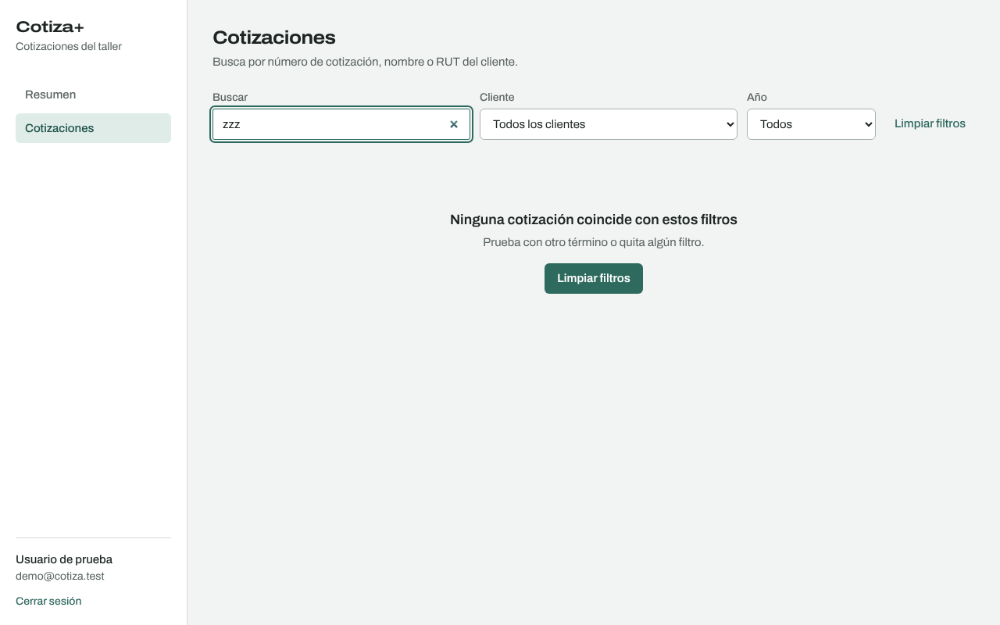
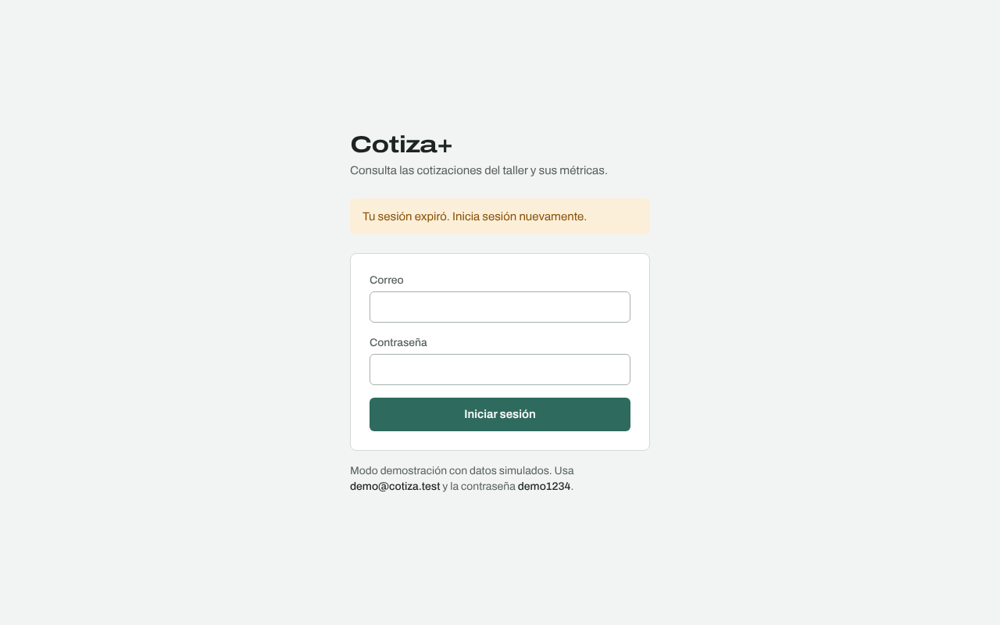
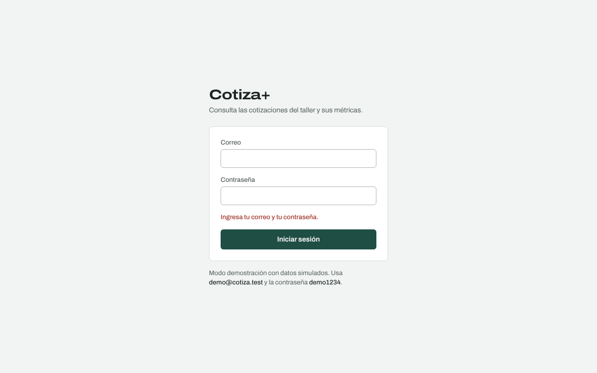
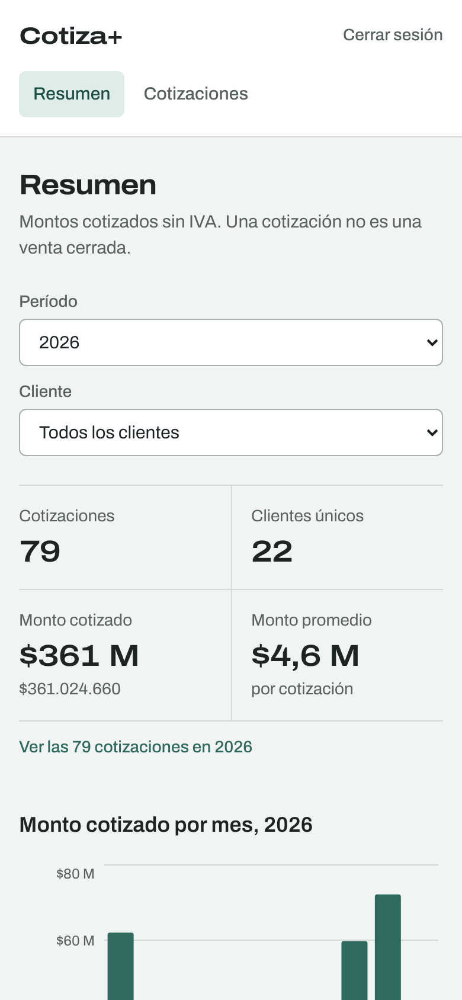
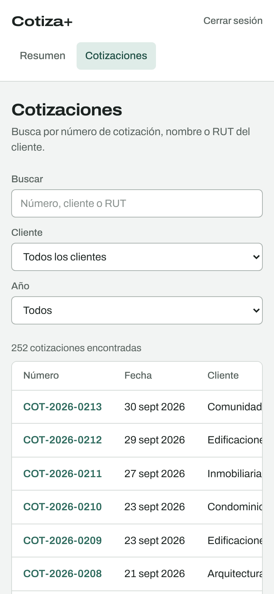

# Diseño de la interfaz — Cotiza+

Documenta las decisiones de diseño de la aplicación web: a quién está dirigida, cómo se organiza, el sistema visual y cómo se resuelven los estados y la accesibilidad. Las capturas corresponden a la aplicación construida con datos simulados.

> No hay un prototipo previo en Figma: el diseño se definió y validó directamente en código, con capturas en cada iteración. Si la asignatura exige un prototipo, se puede reconstruir en Figma a partir de estas pantallas y tokens.

## 1. Usuario y tarea principal

El usuario es una persona del área comercial o de administración de una empresa del rubro del vidrio y aluminio. No es técnica y usa la aplicación para responder preguntas concretas:

- ¿Cuánto hemos cotizado este año, y a cuántos clientes?
- ¿Cómo va este mes comparado con los anteriores?
- ¿Qué le cotizamos a este cliente y por cuánto?
- ¿Dónde está el PDF de la cotización 2025-0163?

Por eso la interfaz tiene solo tres pantallas de trabajo (Resumen, Cotizaciones, Detalle), un menú de dos opciones y ninguna acción que modifique datos.

## 2. Mapa de pantallas

```
/login ──► /  (Resumen) ──► /cotizaciones?anio&cliente_id ──► /cotizaciones/:id (Detalle)
                │                   ▲
                └───────────────────┘  "Ver las N cotizaciones" lleva al listado con los mismos filtros
```

| Pantalla | Pregunta que responde | Captura |
| --- | --- | --- |
| Iniciar sesión | — |  |
| Resumen | ¿Cuánto y a cuántos clientes hemos cotizado en el período? |  |
| Cotizaciones | ¿Qué cotizaciones hay para este cliente, año o búsqueda? |  |
| Detalle | ¿Qué incluye esta cotización y dónde está su PDF? |  |

Los filtros (año, cliente, búsqueda y página) viven en la URL. Así un enlace a "cotizaciones de Hotel Bahía Serena en 2025" se puede compartir, sobrevive a una recarga y el botón "atrás" del navegador funciona como se espera.

## 3. Sistema visual

### Color

La paleta sale del propio rubro: el verde del canto de un cristal flotado como único color de acento, grises de perfil de aluminio para bordes y textos secundarios. Hay un solo color de acento para que el usuario aprenda rápido qué es interactivo (enlaces, botón principal, barras del gráfico).

| Token | Claro | Oscuro | Uso |
| --- | --- | --- | --- |
| `fondo` | `#f2f4f3` | `#141918` | Fondo de la aplicación |
| `superficie` | `#ffffff` | `#1b2220` | Tablas, menú, formulario |
| `texto` | `#1d2422` | `#e3eae7` | Texto principal |
| `texto-suave` | `#57625e` | `#9ba8a3` | Etiquetas y texto secundario |
| `borde` | `#d3d9d6` | `#2f3a37` | Separadores |
| `vidrio` | `#2e6b5e` | `#74bba9` | Acento: enlaces, botón principal, barras |
| `alerta` | `#8a5208` | `#e2a957` | Avisos (sesión expirada) |
| `error` | `#a3362b` | `#ee8d81` | Errores de carga y de login |

Los tokens están en `SRC/frontend/src/index.css` y se adaptan solos al modo oscuro del sistema operativo.



### Tipografía

Una sola familia, **Archivo** (variable), en dos anchos:

- Ancho normal para todo el texto de la interfaz.
- Ancho expandido (118 %) y números tabulares para las cifras del resumen y los totales. Es el elemento con más personalidad de la interfaz: las cifras son lo que el usuario viene a mirar.

Todos los montos de las tablas usan números tabulares y van alineados a la derecha, para comparar columnas de un vistazo.

### Formato de datos

| Dato | Formato | Ejemplo |
| --- | --- | --- |
| Monto en tabla | Pesos chilenos, sin decimales | $1.865.940 |
| Monto destacado | Abreviado, con el valor exacto debajo | $21,6 M / $21.643.810 |
| Fecha | Día, mes abreviado y año | 14 mar 2026 |
| Cantidad | Hasta un decimal, con unidad | 27,4 m² |

Los montos del resumen se rotulan como "cotizados" y "sin IVA", porque una cotización no es una venta cerrada y confundirlas llevaría a conclusiones equivocadas.

## 4. Estados

Cada pantalla resuelve cinco estados, sin pantallas en blanco:

| Estado | Tratamiento | Captura |
| --- | --- | --- |
| Cargando | Indicador con texto ("Buscando cotizaciones…"); al cambiar un filtro se mantienen los datos anteriores atenuados en vez de vaciar la pantalla | — |
| Sin resultados | Explica qué pasó y ofrece una acción ("Limpiar filtros") |  |
| Error de carga | Mensaje concreto y botón "Reintentar" | — |
| Sesión expirada | Vuelve al login con un aviso |  |
| Validación de formulario | Mensaje junto al formulario, sin llamar a la API |  |

Los mensajes describen qué pasó y qué hacer, sin culpar al usuario ni usar códigos técnicos.

## 5. Responsivo

En pantallas angostas el menú lateral pasa a una barra superior, los filtros se apilan, los indicadores quedan en dos columnas y las tablas se desplazan horizontalmente dentro de su recuadro, sin que se desplace la página completa.

| Resumen en móvil | Listado en móvil |
| --- | --- |
|  |  |

## 6. Accesibilidad

- Revisión con axe-core (WCAG 2.1 A y AA): 0 problemas en todas las pantallas, en modo claro y oscuro.
- Todo se puede usar con teclado y el foco es visible.
- Cada campo tiene su etiqueta visible; los errores se anuncian a lectores de pantalla.
- El gráfico tiene una tabla equivalente oculta visualmente para lectores de pantalla.
- Cada pantalla pone su título en la pestaña del navegador.
- Se respeta la preferencia de reducir movimiento del sistema operativo.
