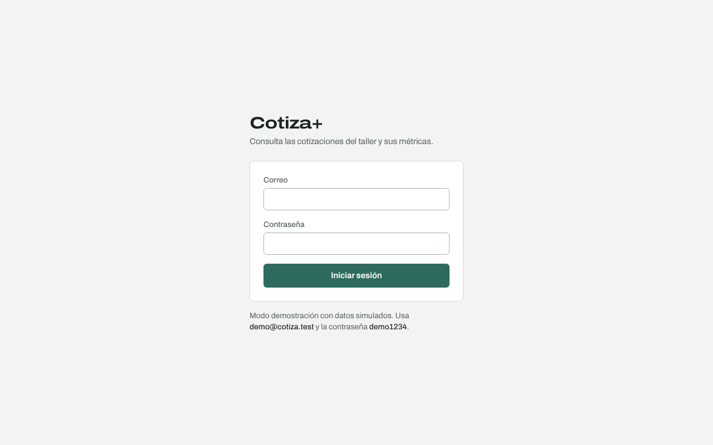
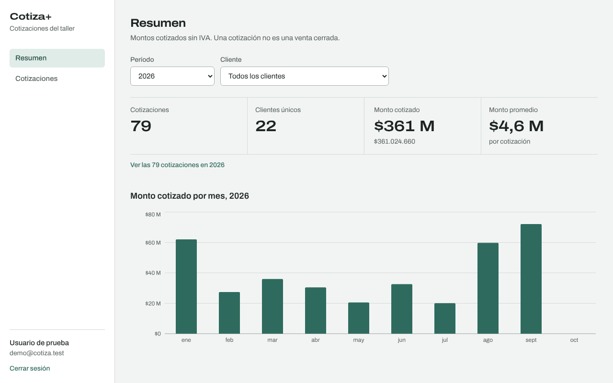
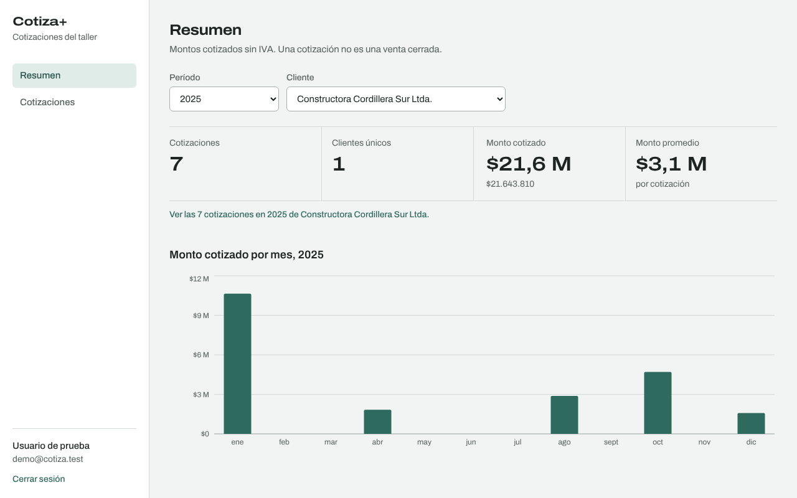
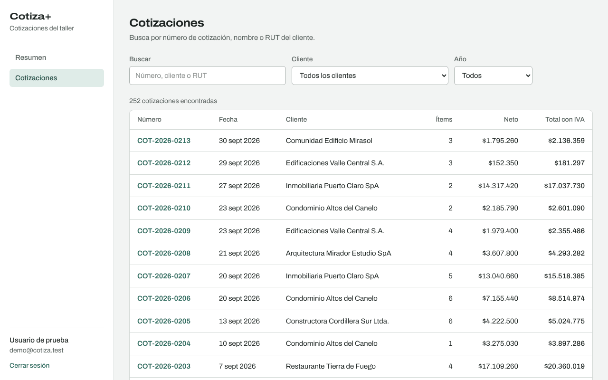
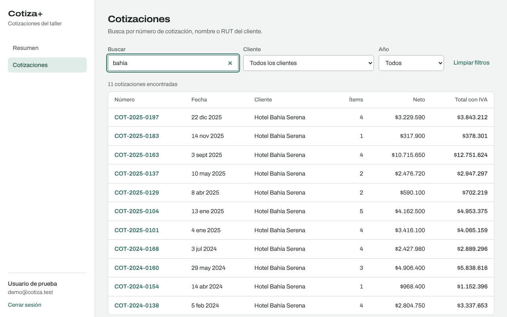
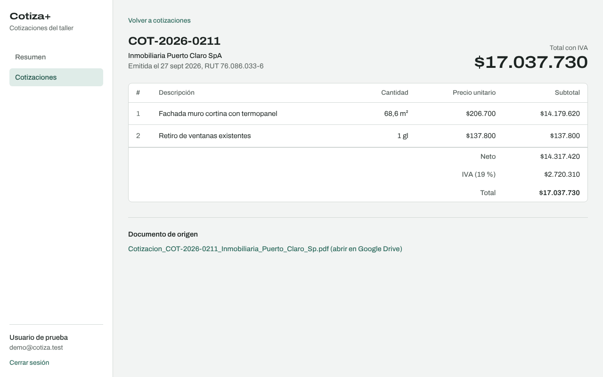

# Manual de usuario — Cotiza+

Cotiza+ reúne en un solo lugar las cotizaciones que la empresa guarda como PDF en Google Drive. Cada vez que se sube una cotización nueva a la carpeta, el sistema lee sus datos (número, cliente, fecha, montos e ítems) y la deja disponible para consultar aquí. No es necesario cargar nada a mano.

> Las imágenes de este manual usan datos ficticios.

## 1. Iniciar sesión

1. Abre la dirección de Cotiza+ que te entregó el administrador.
2. Escribe tu correo y tu contraseña, y presiona **Iniciar sesión**.

Si el correo o la contraseña no son correctos, verás "Correo o contraseña incorrectos.". Por seguridad, el sistema no indica cuál de los dos está mal.

Tu sesión dura un tiempo limitado. Cuando vence, Cotiza+ te devuelve a esta pantalla con el aviso "Tu sesión expiró"; inicia sesión otra vez y volverás a la pantalla en la que estabas.

## 2. Resumen

Es la primera pantalla después de entrar. Muestra cuánto se ha cotizado en el período elegido.

| Indicador | Qué significa |
| --- | --- |
| Cotizaciones | Cantidad de cotizaciones registradas en el período. |
| Clientes únicos | Cuántos clientes distintos recibieron al menos una cotización. |
| Monto cotizado | Suma de los montos netos, **sin IVA**. |
| Monto promedio | Monto cotizado dividido por la cantidad de cotizaciones. |

Importante: son montos **cotizados**, no ventas. Una cotización puede no haberse concretado.

**Cambiar el período o el cliente.** Usa **Período** para elegir un año (o "Todos los años") y **Cliente** para ver solo uno. Con un año elegido, el gráfico muestra cada mes; con "Todos los años", muestra un total por año. Pasa el cursor sobre una barra para ver su monto exacto y la cantidad de cotizaciones.

**Ver las cotizaciones del resumen.** El enlace bajo los indicadores ("Ver las 7 cotizaciones en 2025 de…") abre el listado con los mismos filtros.

## 3. Buscar cotizaciones

Entra a **Cotizaciones** en el menú.

- **Buscar:** escribe un número de cotización (por ejemplo `2025-0163`), parte del nombre del cliente o su RUT. No importan las mayúsculas ni las tildes: "bahia" encuentra "Hotel Bahía Serena". La lista se actualiza sola al dejar de escribir.
- **Cliente** y **Año:** limitan la lista. Se pueden combinar con la búsqueda.
- **Limpiar filtros:** vuelve a mostrar todas las cotizaciones.

La lista muestra primero las más recientes, de a 20 por página. Usa **Anterior** y **Siguiente** para moverte entre páginas.

Si ninguna cotización coincide, verás "Ninguna cotización coincide con estos filtros" y un botón para limpiarlos.

Consejo: la dirección de la página guarda los filtros. Puedes copiarla y enviarla a un compañero para que vea exactamente la misma lista.

## 4. Ver el detalle de una cotización

Haz clic en el número o en cualquier parte de la fila.

Verás el cliente, la fecha de emisión, cada ítem con su cantidad, precio unitario y subtotal, y al final el neto, el IVA y el total. En **Documento de origen** está el enlace para abrir el PDF original en Google Drive.

Usa **Volver a cotizaciones** para regresar a la lista con los mismos filtros que tenías.

## 5. Cerrar sesión

Presiona **Cerrar sesión** (abajo a la izquierda en computador, arriba a la derecha en el celular). Si usas un computador compartido, cierra sesión al terminar. Cerrar la pestaña también termina la sesión.

## 6. Mensajes frecuentes

| Mensaje | Qué hacer |
| --- | --- |
| Correo o contraseña incorrectos. | Revisa ambos datos. Si olvidaste la contraseña, pídele una nueva al administrador. |
| Tu sesión expiró. Inicia sesión nuevamente. | Vuelve a entrar; regresarás a donde estabas. |
| No se pudo conectar con el servidor. | Revisa tu conexión a internet y presiona **Reintentar**. |
| El servidor tuvo un problema. | Espera unos minutos y presiona **Reintentar**. Si continúa, avisa al administrador. |
| No encontramos esta cotización. | El enlace está incompleto o la cotización ya no existe. Vuelve al listado y búscala. |
| No hay cotizaciones registradas en… | No hay cotizaciones para ese período o cliente. Prueba con otro año o con "Todos los clientes". |

## 7. Preguntas frecuentes

**Subí una cotización a Drive y no aparece.** El sistema la procesa automáticamente, pero puede tardar unos minutos. Si sigue sin aparecer, puede que el PDF sea un escaneo sin texto o esté protegido con contraseña; avísale al administrador.

**¿Puedo editar o borrar una cotización desde aquí?** No. Cotiza+ solo consulta; la fuente de verdad es el PDF en Drive.

**¿Funciona en el celular?** Sí. En pantallas pequeñas el menú queda arriba y las tablas se desplazan hacia los lados.
